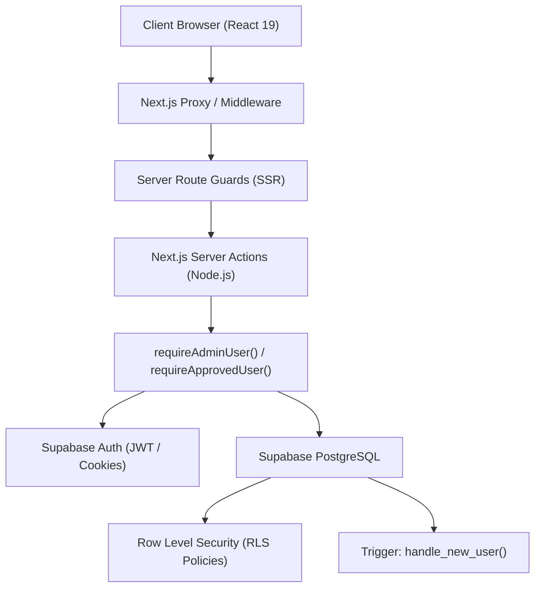

<p align="center">
  
</p>

<h1 align="center">
  User Management System (UMS)
  <br>
  
</h1>

<h3 align="center"><em>Enterprise-Grade User Management & Administrator Review Platform</em></h3>

<p align="center">
  <a href="https://nextjs.org/"></a>
  <a href="https://react.dev/"></a>
  <a href="https://www.typescriptlang.org/"></a>
  <a href="https://tailwindcss.com/"></a>
  <a href="https://supabase.com/"></a>
  <a href="https://www.postgresql.org/"></a>
</p>

<h3 align="center">
  <strong>Local URL:</strong> <a href="http://localhost:3000">http://localhost:3000</a>
</h3>

<p align="center">
  <strong>User Management System (UMS)</strong> is a production-ready, full-stack web application designed for robust identity management, multi-tier role-based access control (RBAC), and an administrator review pipeline. Built with <strong>Next.js 16 (App Router)</strong>, <strong>TypeScript</strong>, <strong>Tailwind CSS</strong>, and <strong>Supabase (Auth + PostgreSQL RLS)</strong>.
</p>

<hr />

## 📋 Table of Contents

- [🎯 Reference & Scope](#-reference--scope)
- [✨ Core Features](#-core-features)
- [🎨 Visual & Interaction Fidelity](#-visual--interaction-fidelity)
- [🏗️ Architecture & Security](#️-architecture--security)
- [🧰 Tech Stack](#-tech-stack)
- [🤖 AI Workflow & Verification Suite](#-ai-workflow--verification-suite)
- [📁 Project Structure](#-project-structure)
- [🚀 Local Development](#-local-development)
- [📦 Production Build & Quality Gates](#-production-build--quality-gates)
- [🔐 Database Schema & RLS Setup](#-database-schema--rls-setup)
- [👑 Admin Provisioning](#-admin-provisioning)
- [👨💻 Author](#-author)

---

## 🎯 Reference & Scope

This project implements the complete technical specification for the **User Management System Internship Technical Assessment**. The system is architected into two strictly segregated portals:

1. **User Panel:** Self-service registration, real-time pending approval gate, interactive profile dashboard, notifications center, account activity timeline, and complete support ticketing system.
2. **Admin Panel:** Secure authentication portal, live system metrics, full user lifecycle management (Approve, Reject, Deactivate, Reactivate, Delete), and an administrative support helpdesk with threaded messaging.

---

## ✨ Core Features

### 👤 User Panel
- **Registration & Authentication:** Secure sign-up with password confirmation, inline validation, and automatic pending account creation.
- **Account Approval Gate:** Users cannot access the dashboard until approved by an administrator. Unapproved accounts are cleanly redirected to a dedicated status screen.
- **Dynamic Account Status Screen (`/account-status`):** Real-time feedback for `Pending`, `Approved`, `Rejected`, and `Suspended` states with contextual guidance and actions.
- **User Dashboard (`/user/dashboard`):** High-level account overview displaying account status, active support requests, unread notifications, and quick actions.
- **Profile Management (`/user/profile`):** View and update editable details (full name, phone, bio) with cryptographic protection preventing client-side role or status tampering.
- **Notifications Hub (`/user/notifications`):** Instant notifications for account approval, status changes, and administrative ticket replies.
- **Account Activity Audit (`/user/activity`):** Immutable log of sign-ins, profile edits, and ticket submissions.

### 🛡️ Admin Panel
- **Dedicated Admin Login (`/admin/login`):** Multi-layer authentication validating both Supabase Auth credentials and database `role === 'admin'`. Non-admins are immediately rejected and signed out.
- **Dashboard Metrics (`/admin/dashboard`):** Live database statistics tracking Total Users, Pending Approvals, Active Accounts, and Open Support Tickets.
- **User Directory & Search (`/admin/users`):** Search users by name or email, with dynamic status filtering (`All`, `Pending`, `Approved`, `Rejected`, `Suspended`).
- **Approval Workflow:** One-click approval or rejection of pending registrations with automated notification dispatch.
- **Account Suspension & Reactivation:** Deactivate malicious or inactive accounts while preserving historical records.
- **Safety Guards:**
  - Self-deactivation and self-rejection prevention.
  - Self-deletion prevention.
  - Last-admin protection preventing accidental lockout.
- **Support Queue (`/admin/support`):** Comprehensive ticket queue with status filters and direct access to customer conversations.

### 🎫 Complete Support History Feature
- **Ticket Creation (`/user/support/new`):** Submit support requests with subject, category, priority (`Low`, `Medium`, `High`, `Urgent`), and detailed description.
- **Support History (`/user/support`):** Complete log of user tickets with unique UUID tracking, category badges, and submission timestamps.
- **Threaded Conversation (`/user/support/[id]` & `/admin/support/[id]`):**
  - Real-time conversation thread between user and support team.
  - Support for public replies and administrative internal notes.
  - Status progression: `Open` ➔ `In Progress` ➔ `Resolved` ➔ `Closed`.
  - Automated ticket status update when an administrator replies.

---

## 🎨 Visual & Interaction Fidelity

The application adheres to modern, premium enterprise design principles:
- **Curated Palette:** Slate, Deep Navy (`#0F172A`), Vivid Royal Blue (`#2563EB`), Emerald Green (`#10B981`), and Crimson Red (`#EF4444`).
- **Typography:** Modern typography using Google Font **Outfit** and **Inter** for clean readability.
- **Glassmorphism & Micro-Interactions:** Subtle backdrop blurs (`backdrop-blur-md`), smooth hover states, and card depth transitions.
- **Empty States & Skeletons:** Animated pulse loading skeletons and contextual empty states across all table views and ticket lists.
- **Responsive Layouts:** Desktop sidebar navigation transitioning into a touch-friendly mobile drawer on viewports below 768px.

---

## 🏗️ Architecture & Security



### Security Highlights
1. **Defense-in-Depth Authorization:** Role checks are never delegated solely to the client. Every privileged server action explicitly executes `requireAdminUser()`.
2. **Escalation-Proof Triggers:** The `handle_new_user()` PostgreSQL trigger hardcodes `role = 'user'` and `account_status = 'pending'`, discarding any client-forged metadata.
3. **Strict Row Level Security (RLS):**
   - Users can only read their own tickets, messages, notifications, and activity logs.
   - Profile `UPDATE` policy enforces `WITH CHECK` to prevent updating `role` or `account_status`.
4. **Secret Key Isolation:** `SUPABASE_SERVICE_ROLE_KEY` is strictly confined to server-side Node.js utilities and never bundled in client assets.
5. **Environment Protection:** `.env.local` is strictly excluded from version control via `.gitignore`.

---

## 🧰 Tech Stack

### Frontend
- **Framework:** Next.js 16 (App Router with Turbopack)
- **Library:** React 19
- **Language:** TypeScript 5 (Strict Mode)
- **Styling:** Tailwind CSS + Vanilla CSS Design Tokens
- **Icons:** Lucide React

### Backend & Cloud
- **Runtime:** Node.js 22 (LTS)
- **Database:** Supabase PostgreSQL
- **Authentication:** Supabase Auth (SSR Cookie Sessions)
- **Security:** PostgreSQL Row Level Security (RLS) & Server Actions

---

## 🤖 AI Workflow & Verification Suite

This application was engineered with a disciplined multi-phase development and automated verification lifecycle:

### Quality Assurance Verification
- **Automated Type Checking:** `npx tsc --noEmit` verifies zero TypeScript compiler errors.
- **Code Standards:** `npm run lint` enforces ESLint rules across all routes and components.
- **Production Build:** `npm run build` compiles all 17 static and dynamic App Router endpoints.
- **End-to-End Chrome Testing:** Verified in Google Chrome with responsive checks (mobile 375px & desktop 1280px).

---

## 📁 Project Structure

```text
USER MANAGEMENT SYSTEM/
├── app/
│   ├── (public)/
│   │   ├── page.tsx                     # Landing Page
│   │   ├── login/page.tsx               # User Sign In
│   │   ├── register/page.tsx            # User Registration
│   │   └── account-status/page.tsx      # Dynamic Account Status Banner
│   ├── admin/
│   │   ├── login/page.tsx               # Admin Portal Login
│   │   ├── actions.ts                   # Privileged Admin Server Actions
│   │   └── (protected)/                 # Guarded Admin Routes (requireAdminUser)
│   │       ├── layout.tsx               # Admin Shell & Navigation
│   │       ├── dashboard/page.tsx       # Live Admin Statistics
│   │       ├── users/page.tsx           # User Management & Status Actions
│   │       └── support/                 # Support Queue & Conversation Threads
│   └── user/                            # Guarded User Routes (requireApprovedUser)
│       ├── layout.tsx                   # User Portal Shell & Sidebar
│       ├── dashboard/page.tsx           # User Dashboard
│       ├── profile/page.tsx             # Profile Details & Edit
│       ├── notifications/page.tsx       # Notifications Hub
│       ├── activity/page.tsx            # Activity Log Timeline
│       └── support/                     # Support History & Ticket Creation
├── components/
│   ├── layout/                          # Navbar, Sidebar, DashboardLayout
│   └── ui/                              # Button, Card, Input, Modal, Badge, etc.
├── lib/
│   ├── supabase/                        # SSR Client, Browser Client, Server Auth Guards
│   └── utils.ts                         # Class merging and formatting utilities
├── public/
│   └── logo.png                         # Transparent UMS Brand Emblem
├── supabase/
│   └── schema.sql                       # Complete PostgreSQL Schema & RLS Policies
├── types/
│   └── database.ts                      # Supabase TypeScript Schema Definitions
├── run-user-management.bat              # One-Click Windows Launch Script
├── package.json
└── README.md
```

---

## 🚀 Local Development

### 1. Prerequisites
- **Node.js:** v18.0.0 or higher (v20+ recommended)
- **npm:** v9.0.0 or higher
- **Supabase Account:** Free project at [supabase.com](https://supabase.com)

### 2. Clone or Extract Project
Open the project directory in your terminal:
```bash
cd "D:\CodingSpace\Projects\USER MANAGEMENT SYSTEM"
```

### 3. Install Dependencies
```bash
npm install
```

### 4. Configure Environment Variables
Create a `.env.local` file in the root directory:
```env
NEXT_PUBLIC_SUPABASE_URL=https://your-project.supabase.co
NEXT_PUBLIC_SUPABASE_ANON_KEY=your-anon-publishable-key
SUPABASE_SERVICE_ROLE_KEY=your-service-role-secret-key
NEXT_PUBLIC_APP_URL=http://localhost:3000
```

### 5. Launch the Application

#### Option A: One-Click Batch Script (Windows)
Double-click `run-user-management.bat` in the project root, or execute:
```cmd
run-user-management.bat
```

#### Option B: Standard CLI
```bash
npm run dev
```

Open [http://localhost:3000](http://localhost:3000) in your browser.

---

## 📦 Production Build & Quality Gates

Run the automated verification suite before submitting or deploying:

```bash
# 1. Type Check
npx tsc --noEmit

# 2. Lint Check
npm run lint

# 3. Production Build
npm run build
```

---

## 🔐 Database Schema & RLS Setup

Initialize your Supabase project by executing the contents of [`supabase/schema.sql`](file:///d:/CodingSpace/Projects/USER%20MANAGEMENT%20SYSTEM/supabase/schema.sql) in the **Supabase SQL Editor**:

1. Open your project on [Supabase Dashboard](https://supabase.com/dashboard).
2. Navigate to the **SQL Editor** tab.
3. Paste the contents of `supabase/schema.sql` and click **Run**.
4. The script creates:
   - Tables: `profiles`, `support_tickets`, `support_messages`, `notifications`, `activity_logs`.
   - Enums: `user_role`, `account_status`, `ticket_status`, `ticket_priority`, `notification_type`.
   - Triggers: Automatic user profile generation on sign-up (`handle_new_user`).
   - RLS Policies: Complete read/write security rules for users and administrators.

---

## 👑 Admin Provisioning

The application does not use any hardcoded admin passwords. To safely promote any registered account to administrator:

1. Register an account through `/register` (e.g., `admin@gmail.com`).
2. Open the **Supabase SQL Editor** and run:
   ```sql
   UPDATE public.profiles
   SET 
     role = 'admin',
     account_status = 'approved',
     updated_at = NOW()
   WHERE email = 'admin@gmail.com';
   ```
3. Verify the role update:
   ```sql
   SELECT id, email, full_name, role, account_status 
   FROM public.profiles 
   WHERE email = 'admin@gmail.com';
   ```
4. Navigate to `http://localhost:3000/admin/login` and sign in with your credentials.

---

## 👨💻 Author

**Hashmil Muhammed**  
*Full-Stack Engineer & Technical Assessment Candidate*
